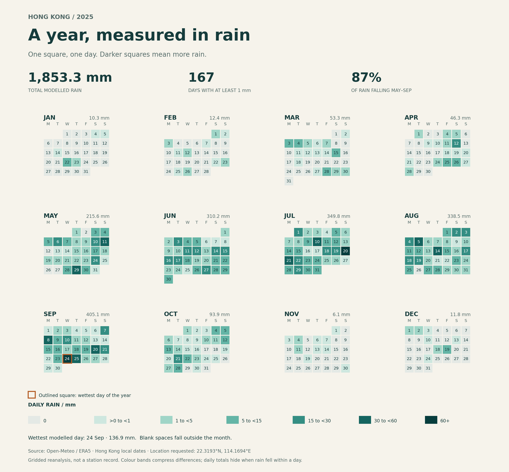

# Hong Kong rainfall, 2025

A year of rain, read one day at a time. This project visualises daily rainfall for a grid cell near Hong Kong throughout 2025. Rain is a familiar part of life in the city, but a yearly total hides how unevenly it arrives. The calendar asks a simple question: when did most of the year's rain fall?



## Data and source

The source is the [Open-Meteo Historical Weather API](https://open-meteo.com/en/docs/historical-weather-api), using the ERA5 model. The [exact request](https://archive-api.open-meteo.com/v1/archive?latitude=22.3193&longitude=114.1694&start_date=2025-01-01&end_date=2025-12-31&daily=rain_sum&timezone=Asia%2FHong_Kong&models=era5) specifies 22.3193 N, 114.1694 E. The response identifies the selected grid position as **22.50 N, 114.25 E**. It is gridded reanalysis derived from observations and modelling, not a Hong Kong Observatory station record or a citywide average.

The original JSON contains 365 paired daily records in `daily.time` and `daily.rain_sum`. Each pair means one local calendar date and its total rain in millimetres, in the Asia/Hong_Kong timezone. The unchanged response is saved in `data/hong-kong-rain-2025.json`, retrieved on 29 September 2026. Data attribution: Open-Meteo and the ERA5 dataset; Open-Meteo distributes API data under [CC BY 4.0](https://creativecommons.org/licenses/by/4.0/).

## Reading the picture

Every numbered square represents a date, with Monday at the left; darker colours indicate larger daily totals, and blank spaces fall outside the month. In this snapshot, May through September account for 87.37% of the year's 1,853.3 mm, and the largest daily total is 136.9 mm on 24 September. The colour bands hide exact differences within each band, daily aggregation hides hourly timing and intensity, and a single model grid cell hides spatial variation across Hong Kong; the picture cannot identify the cause of an individual rainy day.

An orange outline marks the wettest day of the year (the earliest date if values tie). Month headings include their rainfall totals. The headline count of 167 days uses an explicit threshold of at least 1 mm. Zero rain has its own colour; positive values below 1 mm occupy a separate band. The program rejects missing, negative, non-finite, duplicated or out-of-order daily data instead of silently discarding it.

## Run

```sh
uv run plot.py
```

## Monthly statistics

Each run also writes [a monthly summary CSV](out/rainfall-monthly-summary-2025.csv), which can be opened in a spreadsheet. Its twelve rows contain the month, total rainfall in mm, number of days with at least 1 mm, wettest date and that day's rainfall in mm. Tied wettest dates use the earliest date. Statistics use the original daily values before colour banding.

## Reproducibility

The plot reads only the saved JSON and writes PNG, SVG and monthly summary CSV files to `out/`. Once uv has installed the declared dependency on the first run, subsequent runs can work offline. `fetch.py` documents the original request and preserves an existing snapshot instead of refreshing it. No API key is required. The raw file's SHA-256 is `ac6b76144b3cc60ecb7095405c0616d91c61be09b166d8c63242cbfaf8078527`.

## Assignment status

This is a first local version, based on the [course template](https://github.com/sd5913/assignment-2-template). The Python scripts, text and visualisation replace its temperature example. For submission, these folder contents must become the root of a public repository named `hong-kong-rainfall`, under the student's own account. The included check workflow is intended for that standalone repository. A genuine history of work on more than one day and final student review are still required; the parent essay repository's history is not this project's process.
