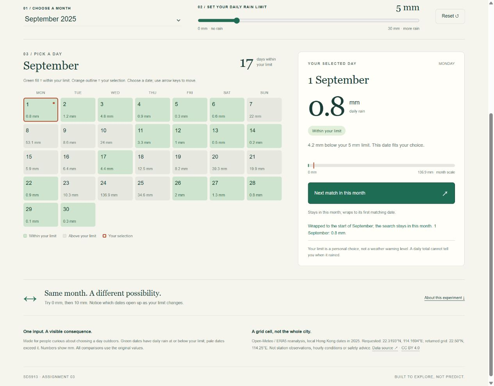

# Rain Window — a day for a walk

An interactive archive for someone curious about choosing a day outdoors in Hong Kong. Instead of only looking at a static rainfall calendar, set a personal daily rain limit, choose a date, and compare that date with the limit. Then find the next date that fits. This is a retrospective experiment using 2025 modelled daily rainfall, **not a weather forecast or a trip-planning service**.



[Mobile interaction screenshot](screenshots/mobile.jpg)

## Run

Requires Python 3 to serve files and a modern browser with JavaScript. There are no package installs, API keys, accounts, fonts from a CDN or runtime external-service dependencies.

From this folder:

```sh
python -m http.server 8000 --bind 127.0.0.1
```

Open <http://127.0.0.1:8000/>. Stop the server with Ctrl+C. If running from the parent repository, open <http://127.0.0.1:8000/rain-window/> instead. Do not double-click index.html: browser restrictions can prevent loading the JSON over file://.

## Main interaction

1. Choose a month and set a daily rain limit from 0 to 30 mm.
2. Green dates have rain **at or below** that limit; other dates are above it. Every date shows the original daily amount, so colour is not the only feedback.
3. Select a date to see its exact rain and the difference from your limit. The calendar help and legend explicitly identify the orange outline as your selection, independently of whether it matches.
4. Use **Next match in this month** to search forward within the month. The search wraps to the beginning with an explicit message. With no match, it suggests changing the limit or month. Repeated clicks move through matches; there are no network requests or accumulated side effects.
5. **Reset** restores 24 September and a 5 mm limit. No choices are persisted or transmitted.

Keyboard: Tab moves between the month, slider, Reset, the selected date and the next-date button. Use the slider's arrow keys to change the limit, and arrow keys on a date to move one day or one week. Home/End selects the first/last day of the month. Date buttons announce the amount and whether it matches; a live status reports the result. The current calendar selection is one Tab stop, so reaching the next action does not require tabbing through every date.

## Verification

Optional developer checks require Node.js 18 or newer, independently of the Python/browser run path. No npm install is needed:

```sh
node --check app.js
node --test tests/engine.test.mjs
```

The ten automated tests cover the saved archive, dates and totals, the inclusive threshold, search progression and wraparound, an only-match case, a no-match case, and malformed/missing data. Browser checks covered date selection, changing the limit, a 31-to-28-day month transition, keyboard movement, reset, and restoring a temporarily missing JSON file followed by **Try again**. Layout was checked at 1280 px and 390 px widths without horizontal overflow.

If data is missing, invalid or unavailable, the interactive controls are hidden and the page gives an explanation and a Retry button. An 8-second timeout prevents an indefinite loading state; repeated retry clicks cannot start overlapping requests. The snapshot is never silently replaced with zeroes. JavaScript module files use `.js`, because Windows Python servers can serve `.mjs` as text/plain rather than a valid module MIME type.

## Data and credits

`data/rainfall-2025.json` is a byte-for-byte copy of the snapshot used by the earlier `hong-kong-rainfall` project in this repository, retrieved on 29 September 2026. Source: [Open-Meteo Historical Weather API](https://open-meteo.com/en/docs/historical-weather-api), ERA5 reanalysis; attribution under [CC BY 4.0](https://creativecommons.org/licenses/by/4.0/). Requested coordinates: 22.3193 N, 114.1694 E; returned model grid: 22.50 N, 114.25 E. All 365 dates use Asia/Hong_Kong. SHA-256: `ac6b76144b3cc60ecb7095405c0616d91c61be09b166d8c63242cbfaf8078527`.

The earlier assignment supplied the data and calendar idea. This new folder is independently runnable and adds deliberate input, threshold filtering, selected-date feedback, forward search, reset and loading recovery. Its HTML, CSS, JavaScript and small SVG icon were written with Codex assistance; no tutorial code, third-party UI framework, borrowed images or course-template implementation is included. See [PROCESS.md](PROCESS.md).

## Limitations and submission status

A daily total hides the time and duration of rain. One reanalysis grid cell is not a station observation or a citywide average. Matching a personal threshold says nothing about warnings, comfort or safety. The archive covers 2025 only. There is no hosted live version configured; the source can run locally with the command above.

Classmate feedback relayed by the student is recorded in [PROCESS.md](PROCESS.md), together with the resulting selection-label and search-scope improvements. The revised wording has not yet been re-tested by that classmate. This folder lives inside the requested public course repository; submit the repository URL with a pointer to `rain-window/` and check any instructor-specific repository layout requirements.
